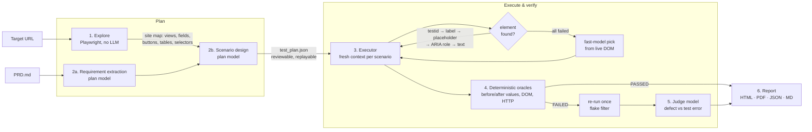

# Spec-Driven Agentic QA

An AI QA agent that answers one question: **does the running application behave the way its PRD says it should?**

Give it a URL and a PRD. It explores the site, turns the PRD into verifiable requirements, designs normal / negative / edge scenarios, drives a real browser, verifies outcomes from observed state (balances, rows, messages, HTTP traffic) and produces an audit report with requirement-level verdicts, reproducible bug evidence and an exact cost breakdown.

```
python run.py --url <target-url> --prd ../test-website/PRD.md
```

---

## Architecture



| Stage | Module | LLM? | What it does |
|---|---|---|---|
| Explore | `qa_agent/explorer.py` | no | Clicks **Enter Demo**, discovers views via links and nav, records fields (labels, types, options, min/max), buttons, tables (headers, row selectors) and stable selectors. Grounds the planner in the real UI. |
| Requirements | `qa_agent/planner.py` | plan model, 1 call | Extracts explicit **and implied** requirements (e.g. "a transfer must also create ledger rows"), each tied to a short PRD quote. |
| Scenarios | `qa_agent/planner.py` | plan model, 1 call per 6 requirements | Writes executable scenarios in a small action/check DSL. Rules force before/after captures, relative deltas, and "error shown **and** state unchanged" for negative tests. A sanitiser drops checks that reference uncaptured variables. |
| Execute | `qa_agent/executor.py`, `runtime.py` | rarely | One isolated browser context per scenario. Self-healing locators, waits on in-flight XHR/fetch + DOM quiescence instead of sleeps, screenshot after every step, full network and console log. |
| Verify | `qa_agent/oracles.py` | no (except `semantic`) | Verdicts come from facts: `{after} == {before} - 25.5` over captured numbers (0.005 money tolerance, safe AST evaluator), row counts, regex formats, visible validation state, HTTP 5xx, uncaught JS errors. |
| Confirm | `qa_agent/executor.py`, `verifier.py` | judge model, failures only | Failures are re-run in a clean context; inconsistent results become *UNVERIFIED (flaky)*. The judge sees evidence + screenshot and may downgrade a test-design mistake to UNVERIFIED, or promote a blocked scenario to a *missing feature*. |
| Report | `qa_agent/report.py` | no | Self-contained HTML (screenshots embedded), PDF, JSON, Markdown. |

### Why the verdicts are trustworthy
- **A click or a success toast is never proof.** Transfers are verified by reading both balances before and after and checking the exact delta; ledgers by counting rows; filters by asserting the excluded value is absent from the table.
- **Three outcomes, not two.** Anything the agent cannot decide with evidence is UNVERIFIED with a reason, never silently PASSED or FAILED.
- **False positives are filtered twice**: a clean re-run (catches races) and a judge review (catches wrong test assumptions).
- **Shared state is expected.** The target is a shared demo, so scenarios assert relative changes rather than seed values.

### Async and unexpected states
- Waits track in-flight `fetch`/XHR requests and a MutationObserver "quiet" window. (Playwright's `networkidle` is a one-time load event and does not cover requests fired after a click. We found this the hard way: it produced false failures on the async transfer form.)
- Element resolution polls until the element appears, then falls back through test id, label, placeholder, ARIA role, exact text, fuzzy text, and finally a fast-model pick from the live DOM. Healed selectors are cached on disk, so each element costs at most one LLM call across all runs.
- Any step that cannot run marks the scenario UNVERIFIED with the failing step, so one broken element never crashes the run.

---

## Testing DemoBank (the hackathon target)

`plans/demobank_plan.json` is a reviewed plan for `test-website/PRD.md`: **26 requirements** (every PRD bullet in Access, Dashboard, Transfers, History, Profile and General UI) and **45 scenarios** (21 normal, 9 negative, 15 edge). It was grounded by running the explorer against DemoBank, so it targets the real labels and `data-testid`s.

Run DemoBank (see `test-website/LOCAL_SETUP.md`), then from this folder:

```bash
# deterministic run on fresh seed data, no LLM needed for execution
python run.py --url http://localhost:5173 --plan plans/demobank_plan.json \
  --reset-cmd "cd ../test-website/database && make reset"

# fully autonomous run: explore + plan from the PRD with the LLM, then execute
python run.py --url http://localhost:5173 --prd ../test-website/PRD.md \
  --reset-cmd "cd ../test-website/database && make reset"
```

What the plan exercises, beyond happy paths:
- **Money integrity:** exact two-sided deltas (including $0.01), the full balance, balance + $0.01, and overdraft. Every rejection must show a message **and** leave both balances and the history count unchanged.
- **Ledger:** one record per transfer, visible in both account histories with amount, accounts, status and memo, surviving a reload and agreeing with the dashboard.
- **Session:** refresh, logout, direct deep links after logout, and Back + reload after logout.
- **Filters:** every visible row must match every active filter. Inclusive start and end dates (including single-day ranges where an evening Pacific time crosses UTC midnight), empty state, clear filters.
- **Privacy:** no full account numbers or UUIDs in visible text, and the profile is masked.
- **UI contract:** double-click submits exactly one request (`request_count`), the layout holds at a 390px width, and error screens offer a way back.

When running in GitHub Codespaces, start DemoBank and the agent in the same Codespace and use `http://localhost:5173`. Forwarded `*.app.github.dev` URLs require a GitHub login, which blocks the agent.

---

## Setup

Python 3.10+.

```bash
cd agent
python -m venv .venv && source .venv/bin/activate      # Windows: .venv\Scripts\activate
pip install -r requirements.txt
playwright install chromium
cp .env.example .env                                     # add your OPENAI_API_KEY, TARGET_URL
```

Any OpenAI-compatible endpoint works (`OPENAI_BASE_URL`, e.g. Azure OpenAI, OpenRouter, a local server). The models must support structured outputs and image input.

## Usage

```bash
# full run: explore → plan → execute → verify → report
python run.py --url https://<organizer-url> --prd ../test-website/PRD.md

# plan only, so you can review/edit artifacts/test_plan.json before executing
python run.py --plan-only

# re-run a saved plan: no planning cost, identical scenarios (good for regression and for the video)
python run.py --plan artifacts/test_plan.json

# watch it work (demo video)
python run.py --plan artifacts/test_plan.json --headed --slow-mo 250 --only SC-04

# options
--types negative edge   --budget 0.50   --no-adjudicate   --no-cache   --out results/
```

Exit code is `1` when defects are found, so it can gate CI.

### Outputs (`artifacts/`)
| File | Contents |
|---|---|
| `qa_audit_report.html` / `.pdf` | Requirement verdicts, defects (severity, repro steps, expected vs observed, captured values, API evidence, screenshots), unverified items with reasons, every scenario, cost tables |
| `qa_audit_report.json` | Everything above, machine-readable |
| `qa_audit_report.md` | Bug list ready to paste into an issue tracker |
| `test_plan.json` | Generated requirements and scenarios (reviewable, replayable) |
| `site_map.json` | What exploration found |
| `screenshots/` | Every step of every attempt |

### Try it offline on the bundled demo target
`examples/demo-bank/` is a small stand-in bank (stdlib Python, synthetic data) with five planted defects, plus a sample plan in the same format the planner produces. It is only for development and is **not** the hackathon target.

```bash
python examples/demo-bank/server.py 8080 &
python run.py --url http://localhost:8080 --plan examples/demo-bank/plan.json   # no API key needed
python run.py --url http://localhost:8080 --prd examples/demo-bank/PRD.md        # full run with LLM
```

The replay finds all five planted defects (cents dropped on credit, negative amounts accepted, >2 decimals accepted, overdraft allowed, Debit filter ignored), with zero false positives across 16 scenarios and $0.00 LLM cost.

---

## Cost

Spend is concentrated where judgement matters; everything else is deterministic code.

| Where | Model tier (default) | Calls per run |
|---|---|---|
| Exploration, execution, oracles, report | none | 0 |
| Requirement extraction | plan (`gpt-4.1`) | 1 |
| Scenario design | plan (`gpt-4.1`) | ⌈requirements / 6⌉; the static prefix (rules + site map + PRD) is reused, so later batches hit OpenAI's prompt cache |
| Element healing | fast (`gpt-4.1-mini`) | only when all locator strategies fail; cached forever per element |
| `semantic` checks | fast (`gpt-4.1-mini`) | only for assertions the DOM cannot express |
| Failure adjudication | judge (`gpt-4.1`) | once per confirmed failure or blocked scenario |

- **Measured, not estimated:** token counts come from each response's `usage` (including image tokens and cached-prompt tokens), priced with `pricing.json`. The report shows cost per model, per stage and per scenario.
- **Local response cache:** an unchanged prompt is answered from `.cache/` for $0. Re-running a saved plan typically costs only the adjudication of new failures.
- **Hard budget:** `MAX_USD` (default $1). When reached, model-dependent checks become UNVERIFIED instead of the run crashing or guessing.
- Rough expectation for a first full run of about 30–40 scenarios: tens of cents, mostly scenario-design output tokens. **Quote the number from your own report, not this estimate.** Check `pricing.json` against the provider's current prices before submitting.

Swap tiers with `PLAN_MODEL`, `FAST_MODEL`, `JUDGE_MODEL`, for example a cheaper plan model once the plan is reviewed, since a saved plan is replayed for free.

---

## Project layout

```
agent/
├── run.py                 CLI entry point
├── pricing.json           $/1M token rates used for the cost report
├── requirements.txt  .env.example
├── qa_agent/
│   ├── config.py          env-driven settings (models, budget, timeouts)
│   ├── llm.py             structured-output gateway, cost ledger, response cache, budget
│   ├── models.py          typed contracts: Requirement, Scenario, Action, Check, results
│   ├── explorer.py        LLM-free site discovery → site map
│   ├── planner.py         PRD → requirements → scenarios (+ sanitiser)
│   ├── runtime.py         Playwright sessions, evidence capture, async waits, self-healing locators
│   ├── executor.py        scenario runner, flake re-run
│   ├── oracles.py         deterministic checks + safe expression evaluator
│   ├── verifier.py        judge-model review of failures
│   └── report.py          HTML / PDF / JSON / Markdown report
├── plans/demobank_plan.json  reviewed plan for the hackathon's DemoBank PRD
├── report/                sample audit report from a DemoBank run
├── examples/demo-bank/    offline stand-in target, PRD and sample plan
└── docs/VIDEO_SCRIPT.md   3–5 minute walkthrough script
```

## Limitations
- Requirements that need things the UI cannot show (server logs, emails, timing SLAs) are reported UNVERIFIED rather than guessed.
- The action DSL covers common web controls; drag-and-drop, file upload and canvas widgets are not implemented.
- DemoBank data is shared and persistent. Use `--reset-cmd` for reproducible numbers. Without a reset, scenarios still assert relative changes, so verdicts hold, but if an overdraft defect is present it leaves balances negative.
- Scenarios run sequentially against a shared demo, so concurrent-user behaviour is not tested. The "rapid repeat" edge cases are the closest proxy.

## Safety
Synthetic data only, no credentials stored (`.env` is git-ignored). The agent only visits the configured origin, runs one browser at a time, and never load-tests the target.
